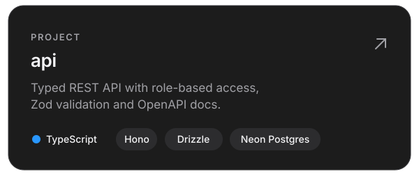
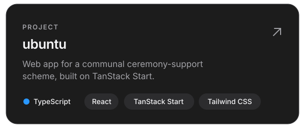
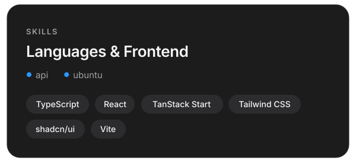
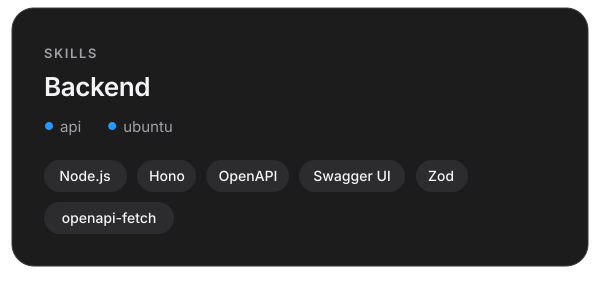
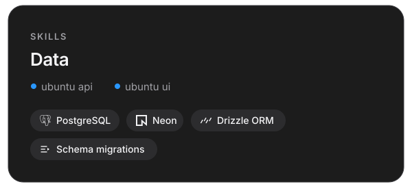
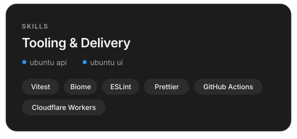
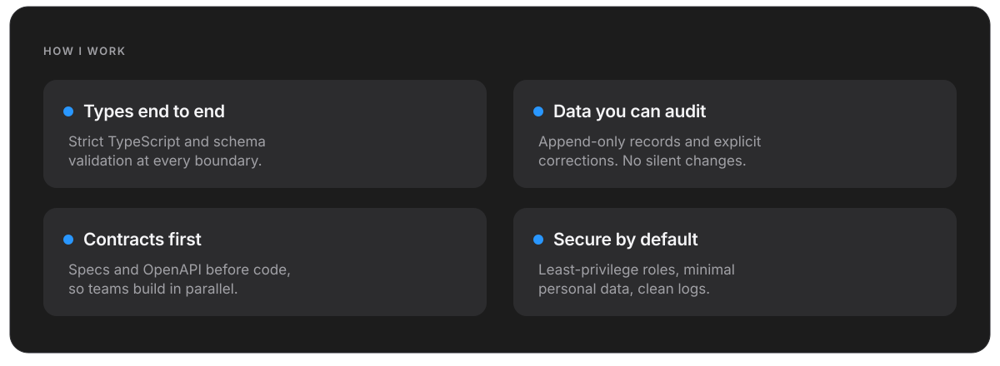

I'm a senior software engineer focused on backend systems: API design, data modelling and services that stay correct under real-world load.
I care about type safety, auditable data and clean interfaces, and about shipping work other engineers enjoy maintaining.

 

### Currently building

  <a href="https://br-mute-poetry-bewqw5un-todos.compute.c-9.us-east-2.aws.neon.tech/">ubuntu api live</a>&nbsp;&nbsp;·&nbsp;&nbsp;<a href="https://ubuntu.sibulelekupelo.workers.dev/">ubuntu ui live</a>&nbsp;&nbsp;·&nbsp;&nbsp;<a href="https://github.com/khanyakupelo01/api">ubuntu api on GitHub</a>&nbsp;&nbsp;·&nbsp;&nbsp;<a href="https://github.com/khanyakupelo01/ubuntu">ubuntu ui on GitHub</a>

  
  

 

### Skills

 

  

Based in South Africa · Open to senior and staff engineering roles

