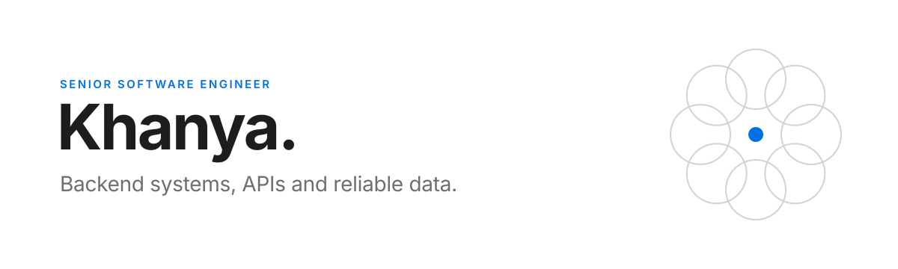
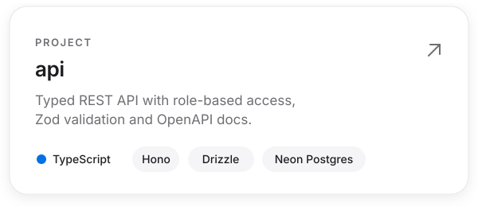
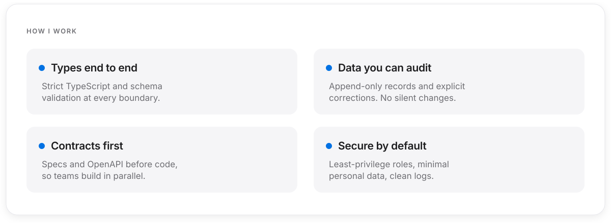

<picture>
  <source media="(prefers-color-scheme: dark)" srcset="./assets/header-dark.svg" />
  
</picture>

I'm a senior software engineer focused on backend systems: API design, data modelling and services that stay correct under real-world load.
I care about type safety, auditable data and clean interfaces, and about shipping work other engineers enjoy maintaining.

 

### Currently building

  <a href="https://github.com/khanyakupelo01/api">
    <picture>
      <source media="(prefers-color-scheme: dark)" srcset="./assets/project-api-dark.svg" />
      
    </picture></a>

  

 

### Skills

<table>
  <tr><th align="left">Category</th><th align="left">Skills</th><th align="left">Evidence</th></tr>
  <tr><td>Languages</td><td>TypeScript, JavaScript, SQL</td><td>TypeScript: <a href="https://github.com/khanyakupelo01/api">api</a>, <a href="https://github.com/khanyakupelo01/ubuntu">ubuntu</a>, hlomela-api, hlomela-web (earlier work). JavaScript: Detailed-Electricity-Usage-Express (earlier work). SQL: electricity database scripts.</td></tr>
  <tr><td>Backend</td><td>Node.js, Hono, Fastify, Express, Zod, OpenAPI / Swagger</td><td>Hono, Zod, OpenAPI: <a href="https://github.com/khanyakupelo01/api">api</a>. Fastify: hlomela-api. Express, Swagger: Detailed-Electricity-Usage-Express (earlier work).</td></tr>
  <tr><td>Data</td><td>PostgreSQL, Neon, Drizzle ORM, schema design</td><td>PostgreSQL, Neon, Drizzle: <a href="https://github.com/khanyakupelo01/api">api</a>, <a href="https://github.com/khanyakupelo01/ubuntu">ubuntu</a>. Schema design: electricity database (owners, properties, transactions).</td></tr>
  <tr><td>Frontend</td><td>React, TanStack Start, Next.js, Tailwind CSS, Vite</td><td>React, TanStack Start, Tailwind, Vite: <a href="https://github.com/khanyakupelo01/ubuntu">ubuntu</a>. Next.js: hlomela-web (earlier work).</td></tr>
  <tr><td>Tooling &amp; Delivery</td><td>Vitest, Mocha, Chai, ESLint, Prettier, Biome, GitHub Actions, Cloudflare Workers</td><td>Vitest, Biome, GitHub Actions: <a href="https://github.com/khanyakupelo01/api">api</a>. ESLint, Prettier, Cloudflare Workers, GitHub Actions: <a href="https://github.com/khanyakupelo01/ubuntu">ubuntu</a>. Mocha, Chai: Detailed-Electricity-Usage-Express (earlier work).</td></tr>
</table>

  

<picture>
  <source media="(prefers-color-scheme: dark)" srcset="./assets/principles-dark.svg" />
  
</picture>

  

Based in South Africa · Open to senior and staff engineering roles

